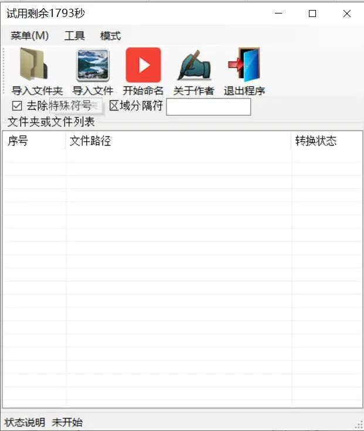

# [Windows Tools] Batch OCR Software for Automated Recognition of Content in Specified Area Images, Version 1.3 User Guide and Notes

OCR Region Auto-Rename Tool Paddle Version 1.3.1 User Guide

OCR region automatic recognition renaming tool Paddle version 1.3.1 usage guide

Tool Introduction

OCR Auto-Rename Tool (Paddle Version 1.3.1) is a batch file renaming tool based on PaddleOCR technology, capable of automatically recognizing text regions in images and extracting the text as the filename. The current algorithm used is the industry-leading PP-OCv5 recognition algorithm.

Software features

(1) Multi-threading for file processing, high efficiency without file limit. (2) Supports multiple region recognition, allows selecting multiple regions through templates, theoretically supports an unlimited number of regions for recognition. (3) Offline recognition, performs recognition offline, and its performance is determined by the computer's own performance. There is no need to worry about data leakage or usage restrictions, nor does it require online connection or application of various APIs for recognition. (4) Support for trial use first, and only then can the tool be used normally. If it is not suitable, it can be discarded without any cost.

Software interface

System requirements

Windows operating system, and >= Windows 10

Recommendation: 8GB or more RAM, and at least 1GB of available hard disk space.

Installation instructions

Download the tool zip file and unzip it. Open FIRC.exe to use it.

No installation required, just run the main program to use it. The green version does not write to the registry and leaves no residue. No installation wizard is needed for installation.

Interface introduction

The tool interface is mainly divided into the following areas:

Top Menu Bar: Includes options such as "Menu", "Tools", and "Mode".

Functional button area: buttons for importing folders, files, and starting naming operations.

Options settings area: options to remove special symbols, separators, etc.

File List Area: Displays the number, path, and conversion status of pending files

Status Bar: Displays the current processing status.

Usage steps

Step 1: Import the file

Import a single file:

Click the "Import File" button

Select the image files that need to be processed in the pop-up file selection window, which supports mainstream image formats such as jpg and png.

Click "Open" to complete the import.

Batch import folder:

Click the "Import Folder" button

Select the folder containing image files.

The tool will automatically scan all image files within the folder.

Step 2: Set options

Remove special symbols:

Check the "☑ Remove special characters" option.

The tool will automatically filter out special characters in file names.

Region delimiter (optional):

If you need to set a region separator, check the corresponding option.

Customizable delimiters between different OCR recognition areas. Note that delimiters cannot be supported by file names, and characters such as \ / : * ? " < > | are reserved for path delimiters, wildcards, or system functions.

Step 3: Begin renaming

Confirm that the files in the file list are correct.

Click the "Start naming" button

The tool will process each file in turn:

Automatically identify text regions in images

Extract text content

Generate a new filename based on the settings.

Rename files

Step 4: Review the results

View the renaming status of each file in the "Transformation Status" column of the file list.

The status bar will display the overall processing progress.

After processing, you can view the renamed file at the original file location.

Notes

The trial version has a (approximately 30 minutes) time limit.

The quality of the image directly affects the OCR recognition effect. It is recommended to use clear images. Since artificial intelligence algorithms cannot guarantee 100% recognition, in some scenarios, they may completely or incorrectly recognize it. Generally, machine-printed computer text recognition is better.

Complex backgrounds or handwritten fonts may affect recognition accuracy.

When dealing with a large number of files, it is recommended to operate in batches.

Common Issues

Q: What should I do if the recognition accuracy is not high? A: Try to improve the quality of the image, ensuring that the text is clear and visible; or adjust the angle of the image so that the text is horizontal.

Q: What should I do after the trial period ends? A: Contact the author for an official version or to extend the trial period.

Q: Processing in progress, the program is not responding? A: It may be due to processing large files or complex images. Please wait patiently or process in batches.

Contact the author

For assistance or feedback, please contact the author through the "About the Author" button.

This tutorial is written based on screenshots of the tool interface. The actual functionality may change with version updates. It is recommended to test the effect before using it by processing a small number of files.

## Payment

Here is a pay link on Stripe ( https://buy.stripe.com/3cs8yP7sY87d0vu9AB ). Please contact me lonlonago@foxmail.com after funding $89, and I will send you a complete data files , thank you!

